# SDP Polars API

## Getting Solana data into the hands of institutions

**Johnnie Tse · MLH Fellowship Summer 2026**
Solana Developer Platform (26.SUM.B.1)
Stakeholder: Waddah Al Drobi, Head of Data, Solana Foundation

`github.com/waldruupi/tmp-sdp-data` · verified 2026-08-05

---

> **Part I** is the overview — what this is, what I shipped, what I learned.
> **Part II** is the engineering reference — architecture, contracts, defects, runbook.
> Read Part I to understand the project. Read Part II to work on it.

---

# Part I — Overview

## The one-slide version

**The problem.** The Solana Foundation has data products — the IDL Index, Rails
tooling, the Data Aggregator — and institutions who want them. There was no
single, open-source service to move that data somewhere those institutions could
query it.

**The approach.** A small Flask service that uses Polars to write Delta Lake
tables into S3, where Databricks reads them **in place**. No copy step, no
nightly ETL job, no database in the middle.

**What that buys you.** One write path. The team pushes data with an HTTP call;
an analyst runs SQL against it seconds later, with no pipeline between them.

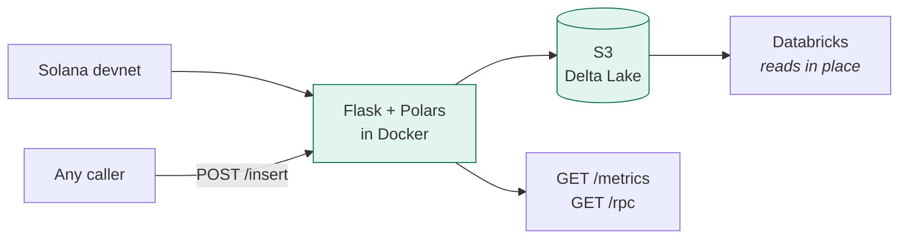

---

## What the project is, in plain terms

Three HTTP endpoints and a storage convention.

| You call | It does | You get |
|---|---|---|
| `POST /insert?table_name=dev.mlh.polars_metrics` | writes your JSON as a Delta table | a table Databricks can query immediately |
| `GET /metrics?days=30` | reads Solana metrics back out of S3 | 30 days of named metrics as JSON |
| `GET /rpc?token_address=…` | reads token transfers from Solana | the last 100 transfers, cached in S3 |

The idea that makes it work is one line of code:

```python
s3_path = table_name.replace(".", "/")
```

`dev.mlh.polars_metrics` becomes `s3://tmp-sdp-data/dev/mlh/polars_metrics/`.
The name you use in Databricks and the place the bytes live are the same thing,
by construction. Nobody has to maintain a mapping.

---

## What I shipped

| Deliverable | State |
|---|---|
| Flask API, three endpoints | done |
| Polars as the data framework | done |
| Delta Lake output on S3 | done |
| Readable from Databricks | Delta protocol v1 — verified by round trip |
| Containerized with Docker | done, image builds and runs healthy |
| **Deployed on ECS** | **blocked on IAM permissions** |

Everything runs and is tested. The one thing outstanding is a permissions
request, not a piece of code.

**By the numbers**

| | |
|---|---|
| Endpoints delivered | 3 of 3 |
| Defects found and fixed | 12 — seven of them silent |
| Verification checks passing | 43 endpoint · 27 end-to-end · 20 unit |
| Server errors across every run | 0 |
| Secrets ever pushed to GitHub | 0, audited across 3,699 blobs |

---

## The pull requests, and how they fit

Two branches, because Waddah asked for two different things at two different
times.

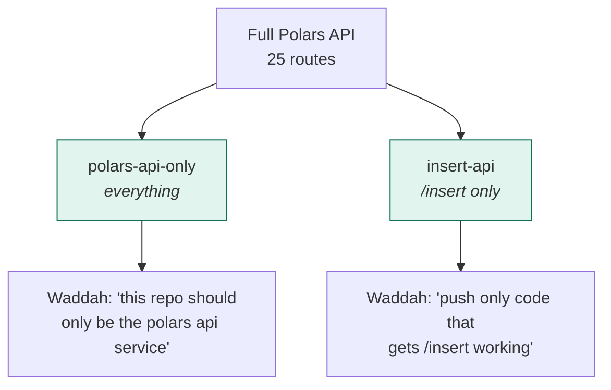

### PR: `insert-api` → `main`

The `/insert` deliverable as a standalone service — 14 files, nothing else.

Where it connects: this is the literal task from the project board — *"Implement
/insert to s3. Must be readable on Databricks."* It writes the 22-row metrics
catalog from Waddah's CSV to `s3://tmp-sdp-data/dev/mlh/polars_metrics`, byte-for
-byte identical to the source.

What is in it, and deliberately nothing more:

```
app.py  config.py  src/routes/insert.py  src/services/s3_service.py
Dockerfile  requirements.txt  README.md  .env.example
queries/databricks-analytics.sql
```

Dropping the other endpoints also dropped four dependencies (APScheduler,
flask-socketio, websockets, numpy), took the image from 775 MB to 701 MB, and
removed the background scheduler — which means this build can run two gunicorn
workers where the full service is pinned to one.

### Branch: `polars-api-only`

The complete service — all three endpoints plus the ingestion pipeline and
WebSocket subsystem. This is the artifact matching the architecture diagram in
the project brief.

The three files that do the actual `/insert` work are **byte-identical** between
the two branches, checked with `cmp`. It is a packaging split, not a fork, so
they cannot drift apart.

### A note on how the PR reads

Both branches came from a `git subtree split`, so they share no commit history
with `main`. GitHub refuses to open a PR across unrelated histories, so the PR
carries a merge commit created with the `ours` strategy — it records `main` as a
parent and pulls in none of its files.

The practical effect: **the diff reads as a replacement, not an increment.**
Reviewers should read the file tree, not the line diff.

---

## Key learnings

**1. Passing tests is not the same as correct data.**

Seven of the twelve defects I found produced no error at all. `/rpc` returned a
*different token* than the one requested, because the parser took the first
token balance change it found and transactions routinely move several. Nothing
crashed. The response looked plausible. It was simply wrong.

The lesson: for a data service, "no exception" is a very weak signal. I only
caught these by comparing output against the source of truth.

**2. Reading the spec beat reasoning about the code.**

Three `/rpc` defects came directly from the Solana RPC `json-structures` docs:
`owner` is optional in token balances, `uiAmount` is deprecated and often
`null`, and balances must be matched by `accountIndex`. I had read the code
several times without seeing them. Ten minutes with the specification found all
three.

**3. Measure the environment, not just the code.**

I twice reported problems that did not exist, because my *measurement* was
broken rather than the branches. Git Bash silently rewrote `ref:path` arguments
into Windows paths, and `git grep -I` skipped a file that had null bytes in it
— reporting a missing `.env` rule that was actually on line 2.

Both times the tool failed quietly and I nearly acted on it. Now I verify the
measurement before trusting the finding.

**4. Credentials are where local and production diverge.**

The service resolved AWS credentials by reading two environment variables. That
works on a laptop. It fails on ECS, because task roles deliver *temporary*
credentials through a container endpoint and require a session token that was
never being forwarded — and it fails *silently*, because the Parquet write used
boto3's full chain and succeeded while the Delta write did not.

That bug would have surfaced on deploy day. It was found by testing the
credential path deliberately, not by running the app.

**5. Ask what the deliverable actually is.**

The service grew to 25 routes. The brief asked for three. Most of the
operational risk — the background scheduler forcing a single gunicorn worker,
the WebSocket subsystem needing a different worker class — came from code
nobody had asked for. The narrower `insert-api` build has none of those
problems.

---

## Next steps

**Immediate — this closes the project**

1. **Get ECS/ECR IAM from Waddah.** `ecr:*`, `ecs:*`, and an
   `sdp-polars-api-task-role` with `s3:GetObject`, `s3:PutObject`,
   `s3:ListBucket` on `tmp-sdp-data`. This is the only outstanding deliverable
   and it is a permissions request, not engineering.
2. **Run one query inside Databricks.** The Delta round trip is proven from S3;
   nobody has yet run `SELECT * FROM delta.\`s3://…\`` in the workspace. Two
   minutes turns an inference into an observation.
3. **Deploy.** The task definition needs three corrections first — memory raised
   from 512 MB (Polars and pyarrow alone need ~300 MB resident), a longer
   healthcheck `startPeriod`, and the ingestion flags set explicitly.

**Shortly after**

4. **Move the scheduler out of the web process** so the service scales
   horizontally instead of being pinned to one worker.
5. **Add a DynamoDB locking provider** before running multiple ECS tasks — Delta
   writes currently rely on `AWS_S3_ALLOW_UNSAFE_RENAME`, which held under 12
   concurrent writers in testing but is not a guarantee.
6. **Retire the legacy Parquet mirror** once nothing reads the `insert/` prefix.

**Longer term**

7. Integrate into the Solana Developer Platform proper, which is the point of
   the fellowship project.
8. Add CI — the verification suites in this repo are all manual today.

---

# Part II — Engineering reference

## Table of contents

1. [Executive summary](#1-executive-summary)
2. [System architecture](#2-system-architecture)
3. [Repository layout](#3-repository-layout)
4. [Component reference](#4-component-reference)
5. [Request lifecycles](#5-request-lifecycles)
6. [Storage layer — S3 and Delta Lake](#6-storage-layer--s3-and-delta-lake)
7. [Databricks integration](#7-databricks-integration)
8. [Credential resolution](#8-credential-resolution)
9. [Configuration reference](#9-configuration-reference)
10. [API contracts](#10-api-contracts)
11. [Deployment topology](#11-deployment-topology)
12. [Defects found and fixed](#12-defects-found-and-fixed)
13. [Verification matrix](#13-verification-matrix)
14. [Branch topology](#14-branch-topology)
15. [Operational runbook](#15-operational-runbook)
16. [Known limitations and open items](#16-known-limitations-and-open-items)

---

## 1. Executive summary

The SDP Polars API is a containerized Flask service that moves Solana blockchain
data into an S3-backed Delta Lake, where Databricks reads it **in place** — no
copy step, no ingestion job, no JDBC bridge.

It exists because the Solana Foundation's data products (IDL Index, Rails
tooling, Data Aggregator) need a single, open-source ingestion surface that
institutions can point at.

### Scope as specified

Three endpoints, from the project brief:

| Endpoint | Contract |
|---|---|
| `GET /metrics?days=N` | read Solana overview metrics from Delta data in S3, last 30 days |
| `POST /insert?table_name=X` | write Delta data to S3 that is also readable on Databricks |
| `GET /rpc?token_address=X` | parse token data from an RPC; check S3 first, else read RPC; return last 100 transfers; store in S3 |

Plus: Flask app, containerized with Docker, Polars as the data framework,
deployed on ECS, with `s3://tmp-sdp-data` as the storage root.

### Current status

| Deliverable | State |
|---|---|
| Flask API app | Complete |
| Polars as data framework | Complete |
| Containerize with Docker | Complete — image builds, runs, healthchecks |
| `POST /insert` | Complete — verified byte-exact round trip |
| `GET /metrics` | Complete — 22 named metrics |
| `GET /rpc` | Complete — correct mint, dedupe, honours limit |
| S3 Delta storage | Complete |
| Readable on Databricks | **Inferred, not observed** — see §16 |
| **Deployed on ECS** | **Not done — blocked on IAM** |

---

## 2. System architecture

### 2.1 The expected architecture

This is the target from the project brief, annotated with verification state.

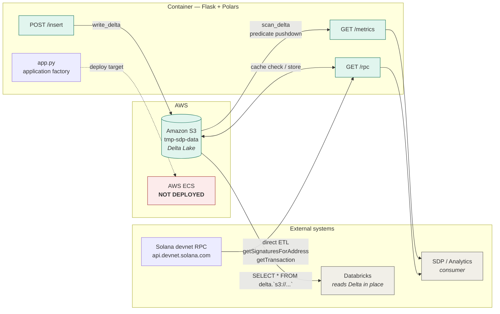

### 2.2 Internal module topology

Every arrow below is an actual Python import or function call.

```mermaid
graph TD
    APP["app.py<br/><i>create_app factory</i>"]
    CFG["config.py<br/><i>frozen dataclass, env-driven</i>"]

    subgraph routes["src/routes/ — HTTP layer"]
        R_INS["insert.py"]
        R_MET["metrics.py"]
        R_RPC["rpc.py"]
        R_ING["ingest.py"]
        R_STB["stablecoins.py"]
        R_MED["stablecoins_median.py"]
        R_NET["network.py"]
        R_TOK["tokens.py"]
        R_HLD["holders.py"]
        R_ANA["analytics.py"]
        R_DBX["databricks_push.py"]
    end

    subgraph services["src/services/ — domain layer"]
        S_S3["s3_service.py<br/><i>write_delta, read_delta,<br/>scan_delta, write_parquet</i>"]
        S_RPC["solana_rpc.py<br/><i>JSON-RPC client, retry,<br/>endpoint rotation</i>"]
        S_ING["ingestion.py"]
        S_SCH["scheduler.py<br/><i>APScheduler, 15 min</i>"]
        S_WS["ws_ingestion.py"]
        S_TD["token_discovery.py"]
        S_TR["token_registry.py"]
        S_DBX["databricks_push.py"]
    end

    subgraph ws["src/websocket/"]
        W_CONN["connection.py"]
        W_HAND["handlers.py"]
        W_ROUTE["routes.py"]
    end

    APP --> CFG
    APP --> routes
    APP --> S_SCH
    APP --> S_WS
    APP --> W_ROUTE

    R_INS --> S_S3
    R_MET --> S_S3
    R_RPC --> S_S3
    R_RPC --> S_RPC
    R_ING --> S_ING
    S_ING --> S_RPC
    S_ING --> S_S3
    S_ING --> S_TD
    S_SCH --> S_ING
    S_WS --> W_CONN
    R_MED --> S_S3
    R_DBX --> S_DBX

    style R_INS fill:#E1F5EE,stroke:#0F6E56
    style R_MET fill:#E1F5EE,stroke:#0F6E56
    style R_RPC fill:#E1F5EE,stroke:#0F6E56
    style S_S3 fill:#E1F5EE,stroke:#0F6E56
```

**Layering rule:** routes never touch boto3 or `deltalake` directly. All storage
access funnels through `s3_service.py`. All RPC access funnels through
`solana_rpc.py`. This is why the credential fix in §12.11 needed exactly one
edit to reach every write path.

### 2.3 Dependency closure of `/insert`

`/insert` is the narrowest deliverable. Its complete transitive closure:

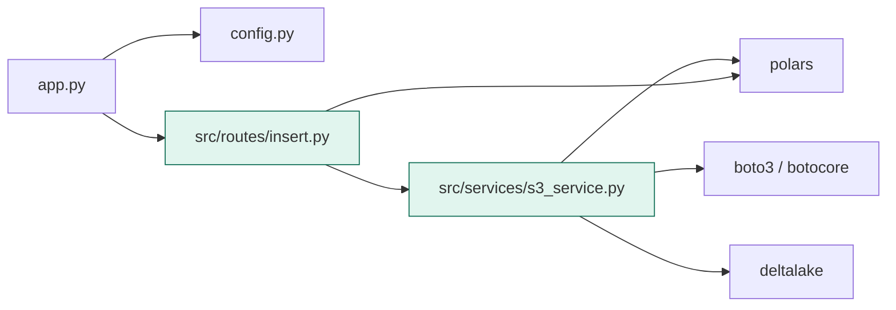

Four first-party modules. Five third-party packages. Verified by AST import
tracing and by booting the app with `apscheduler`, `flask_socketio` and
`websockets` blocked at import — it started cleanly.

---

## 3. Repository layout

```
sdp-polars-api/
├── app.py                          Flask application factory
├── config.py                       frozen dataclass, all env-driven
├── requirements.txt                11 pinned-minimum packages
├── Dockerfile                      python:3.12-slim + gunicorn
├── .dockerignore                   excludes __pycache__, .env, .git, *.md, tests/
├── SETUP.md
│
├── src/
│   ├── routes/                     HTTP layer — 11 blueprints
│   │   ├── insert.py               POST /insert          ← DELIVERABLE
│   │   ├── metrics.py              GET  /metrics         ← DELIVERABLE
│   │   ├── rpc.py                  GET  /rpc             ← DELIVERABLE
│   │   ├── ingest.py               GET/POST /ingest/*    (6 routes)
│   │   ├── stablecoins.py          GET  /stablecoins
│   │   ├── stablecoins_median.py   GET  /stablecoins/median
│   │   ├── network.py              GET  /network
│   │   ├── tokens.py               GET  /tokens, /tokens/<uuid>, POST /tokens/register
│   │   ├── holders.py              GET  /holders, /holders/<mint>
│   │   ├── analytics.py            GET  /analytics
│   │   └── databricks_push.py      GET  /push-to-databricks
│   │
│   ├── services/                   domain layer
│   │   ├── s3_service.py           ← ALL storage I/O passes through here
│   │   ├── solana_rpc.py           ← ALL RPC I/O passes through here
│   │   ├── ingestion.py            snapshot builders
│   │   ├── scheduler.py            APScheduler, 15-minute interval
│   │   ├── ws_ingestion.py         WebSocket ingestion driver
│   │   ├── token_discovery.py      getProgramAccounts + FALLBACK_MINTS
│   │   ├── token_registry.py       token metadata resolution
│   │   └── databricks_push.py      Statement Execution API bridge (legacy)
│   │
│   └── websocket/                  real-time subsystem
│       ├── connection.py           wss:// client, subscribe/unsubscribe
│       ├── handlers.py             slot/logs/program notification handlers
│       └── routes.py               /ws/* blueprint + SocketIO server
│
├── queries/
│   └── databricks-analytics.sql    external-table DDL + analytics queries
│
├── scripts/
│   ├── smoke_test.py               3-endpoint smoke test
│   ├── run-ingestion-loop.ps1
│   └── schedule-ingestion.ps1
│
├── deploy/
│   ├── ecs-task-def.json           ECS task definition
│   ├── deploy-ecs.ps1              deployment driver
│   └── databricks-prod-workspace.md
│
└── docs/
    ├── ARCHITECTURE.md             ← this document
    ├── DEVELOPMENT_LOG_SDP_POLARS_PIPELINE.md
    ├── waddah-message-draft.md
    ├── 2026-07-20-data-aggregator-enhancements-design.md
    └── plans/2026-07-20-data-aggregator-enhancements.md
```

**Totals:** 43 tracked files · 28 Python modules · 25 registered routes.

---

## 4. Component reference

### 4.1 `app.py` — application factory

```python
create_app(cfg: Config | None = None) -> Flask
```

Responsibilities, in order:

1. Configure stdout logging (so Docker/gunicorn capture it)
2. Insert the project root on `sys.path`
3. Instantiate `Config` and stash it at `app.config["APP_CFG"]`
4. Register `/health`
5. Initialise SocketIO (`async_mode="threading"`)
6. Start the ingestion scheduler
7. Start the WebSocket listeners
8. Register 11 route blueprints
9. Register the `/ws` blueprint under `url_prefix="/ws"`

**Critical property:** steps 6 and 7 spawn background threads *inside the
factory*. Gunicorn calls the factory **per worker**, so `--workers 2` would run
two schedulers and duplicate every 15-minute snapshot. The Dockerfile is pinned
to `--workers 1` for this reason, documented inline.

### 4.2 `config.py` — configuration

A frozen dataclass. Every field reads from an environment variable with a
default, so the container is configured entirely through env. No config file,
no secrets in code. See §9 for the full table.

### 4.3 `src/services/s3_service.py` — storage layer

The single chokepoint for all persistence.

| Function | Purpose |
|---|---|
| `_session(cfg)` | boto3 session honouring `AWS_PROFILE` |
| `credentials_available(cfg)` | does the credential chain resolve? |
| `_storage_options(cfg)` | builds the dict delta-rs needs — key, secret, **session token**, region |
| `_client(cfg)` | boto3 S3 client with adaptive retry |
| `write_delta(cfg, table, df, mode, path)` | Delta write; `schema_mode="overwrite"` on overwrite |
| `read_delta(cfg, table, path)` | eager read → `pl.DataFrame` |
| `scan_delta(cfg, table, path)` | **lazy** scan → `pl.LazyFrame`, enables predicate pushdown |
| `write_parquet(cfg, key, df)` | legacy Parquet, via local temp then upload |
| `read_parquet(cfg, key)` | legacy Parquet read |
| `key_exists`, `list_keys` | object existence / enumeration |

**`DELTA_ROOT = "dev/mlh/sdp_data"`** — the default prefix when `path` is not
supplied. `/insert` always supplies `path`, derived from `table_name`.

### 4.4 `src/services/solana_rpc.py` — RPC layer

JSON-RPC client with:

- multi-endpoint rotation via `SOLANA_RPC_URLS`
- exponential backoff, `RPC_MAX_RETRIES` attempts
- 429/403 detection with endpoint failover
- **re-raises** on exhaustion rather than returning `[]`, so callers can surface
  a 502 rather than silently reporting "no data"

---

## 5. Request lifecycles

### 5.1 `POST /insert` — the write path

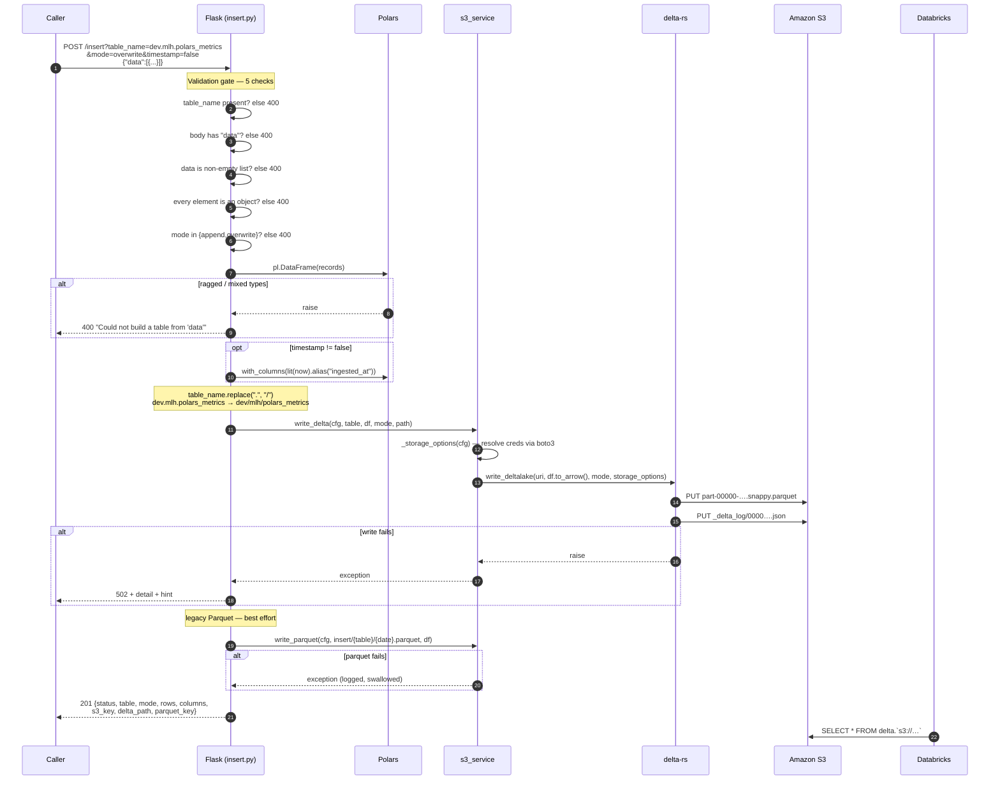

**Why the Parquet write is best-effort:** Delta is what Databricks reads. A
Parquet hiccup must not fail an insert that already succeeded where it counts.

### 5.2 `GET /metrics` — the read path

```mermaid
sequenceDiagram
    autonumber
    participant C as Caller
    participant F as Flask (metrics.py)
    participant S as s3_service
    participant P as Polars
    participant S3 as Amazon S3

    C->>F: GET /metrics?days=30
    F->>F: clamp days to [1, 365]
    Note over F: cutoff = (utcnow - days).date()<br/>DATE, not timestamp — see §12.9

    F->>S: scan_delta(cfg, "dev/mlh/polars_metrics_values")
    S->>P: pl.scan_delta(uri, storage_options)
    P-->>F: LazyFrame

    alt scan returns None
        F-->>C: 503 "Could not read the Delta table…"
    end

    F->>P: .filter(col("date") >= cutoff).collect()
    Note over P,S3: predicate pushed into the scan —<br/>only matching row groups fetched
    P->>S3: ranged GETs
    S3-->>P: parquet row groups

    alt empty result
        F-->>C: 200 {days, metrics: [], count: 0, source}
    end

    F->>S: read_delta("dev/mlh/polars_metrics") — catalog
    Note over F: cached per process; static fallback<br/>map of 22 ids if unreachable
    F->>P: join name_map on metric_id
    F->>P: sort([date, metric_id])
    F->>P: partition_by("date", maintain_order=True)
    F-->>C: 200 {days, count, source, metrics:[{date, <name>: value, …}]}
```

### 5.3 `GET /rpc` — cache-first, RPC fallback

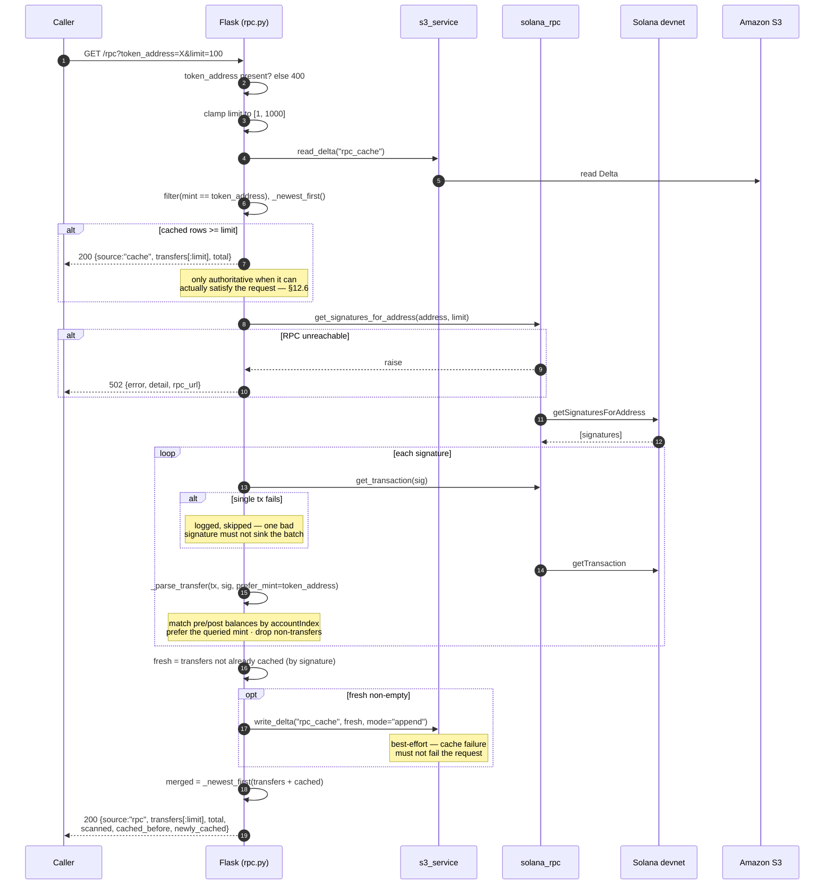

---

## 6. Storage layer — S3 and Delta Lake

### 6.1 Bucket layout

```
s3://tmp-sdp-data/
│
├── dev/mlh/                                    ← Databricks-visible namespace
│   ├── polars_metrics/                         ← THE DELIVERABLE (catalog, 22 rows)
│   │   ├── _delta_log/
│   │   │   ├── 00000000000000000000.json
│   │   │   └── 00000000000000000001.json
│   │   └── part-00000-….snappy.parquet
│   │
│   ├── polars_metrics_values/                  ← Waddah's data (2,217 rows) — READ ONLY
│   │   ├── _delta_log/
│   │   └── part-00000-….snappy.parquet
│   │
│   └── sdp_data/                               ← DELTA_ROOT, pipeline output
│       ├── stablecoins/    network/    holders/
│       ├── whales/         validators/ events/
│       └── rpc_cache/                          ← /rpc cache
│
├── insert/{table}/{date}.parquet               ← legacy Parquet mirror
├── metrics/{table}/{date}.parquet
└── rpc-cache/{token_address}.parquet
```

### 6.2 `table_name` → S3 path mapping

The core mapping, one line in `insert.py`:

```python
s3_path = table_name.replace(".", "/")
```

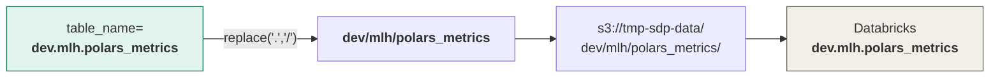

The Databricks three-part name and the storage location stay in lockstep by
construction. This is exactly the equivalence Waddah specified:

```sql
-- his example
select * from solana.idl
select * from delta.`s3://solana-fdn-dw/prod/solana/idl`

-- ours
select * from dev.mlh.polars_metrics
select * from delta.`s3://tmp-sdp-data/dev/mlh/polars_metrics`
```

### 6.3 Delta table anatomy

A written table, exactly as it lands:

```
dev/mlh/polars_metrics/
├── _delta_log/
│   ├── 00000000000000000000.json       version 0 — commitInfo, protocol, metaData, add
│   └── 00000000000000000001.json       version 1 — commitInfo, remove, add
└── part-00000-8628d71a-….snappy.parquet
```

Commit 0, abridged:

```json
{"commitInfo":{"timestamp":1785504904756,"operation":"WRITE",
  "operationParameters":{"mode":"Append"},"engineInfo":"delta-rs:py-1.6.2",
  "operationMetrics":{"num_added_files":1,"num_added_rows":3}}}
{"protocol":{"minReaderVersion":1,"minWriterVersion":2}}
{"metaData":{"id":"dce901ec-…","format":{"provider":"parquet"},
  "schemaString":"{\"type\":\"struct\",\"fields\":[…]}","partitionColumns":[]}}
{"add":{"path":"part-00000-….snappy.parquet","size":1482,
  "stats":"{\"numRecords\":3,\"minValues\":{…},\"maxValues\":{…}}"}}
```

**`minReaderVersion: 1` is deliberate.** Protocol v1 is the widest Databricks
compatibility tier — no deletion vectors, no column mapping, no reader upgrade
required on the consumer side.

### 6.4 Write modes

| Mode | delta-rs behaviour | Use for |
|---|---|---|
| `append` (default) | new commit adding files | fact tables — `polars_metrics_values`, `rpc_cache` |
| `overwrite` | new commit removing + adding, with `schema_mode="overwrite"` | dimension/catalog tables — `polars_metrics` |

`schema_mode="overwrite"` is passed **only** on overwrite. Without it delta-rs
rejects any write whose column set differs from the stored table:

```
SchemaMismatchError: Cannot cast schema, number of fields does not match: 6 vs 5
```

`/insert` catches this and returns a 502 carrying the hint *"Schema differs from
the existing table — retry with mode=overwrite"*.

---

## 7. Databricks integration

### 7.1 How the connection actually works

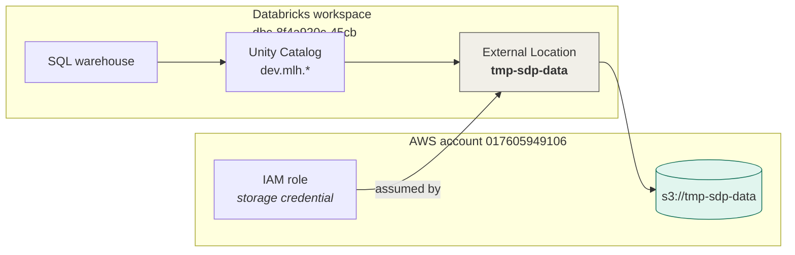

Waddah created the External Location on 2026-07-20. That is the prerequisite —
it lets Unity Catalog reach the bucket without the service holding any
Databricks credential.

### 7.2 Two ways to read

**Ad hoc — no registration:**

```sql
SELECT * FROM delta.`s3://tmp-sdp-data/dev/mlh/polars_metrics`;
```

**Registered external table — zero copy:**

```sql
CREATE SCHEMA IF NOT EXISTS dev.mlh;

CREATE TABLE IF NOT EXISTS dev.mlh.polars_metrics
USING DELTA
LOCATION 's3://tmp-sdp-data/dev/mlh/polars_metrics/';
```

No column list — the schema comes from `_delta_log`. No data movement. Future
`/insert` writes appear on the next query.

`IF NOT EXISTS` rather than `OR REPLACE`: the other entries in
`queries/databricks-analytics.sql` use `OR REPLACE`, which is fine for
cron-rewritten tables but wrong for a path holding appended data.

### 7.3 The data model

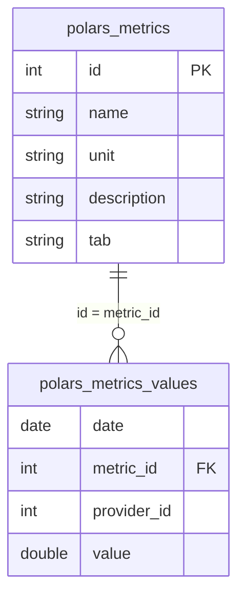

`polars_metrics` is the **dimension** (22 metric definitions, written by
`/insert`). `polars_metrics_values` is the **fact** table (2,217 daily
measurements, populated by Waddah in Databricks). `/metrics` joins them.

This relationship was the key discovery early on: the CSV Waddah supplied was
the catalog, not measurements, and it had been written to S3 under the wrong
table name (`dev/mlh/inserted-values`).

---

## 8. Credential resolution

### 8.1 The chain

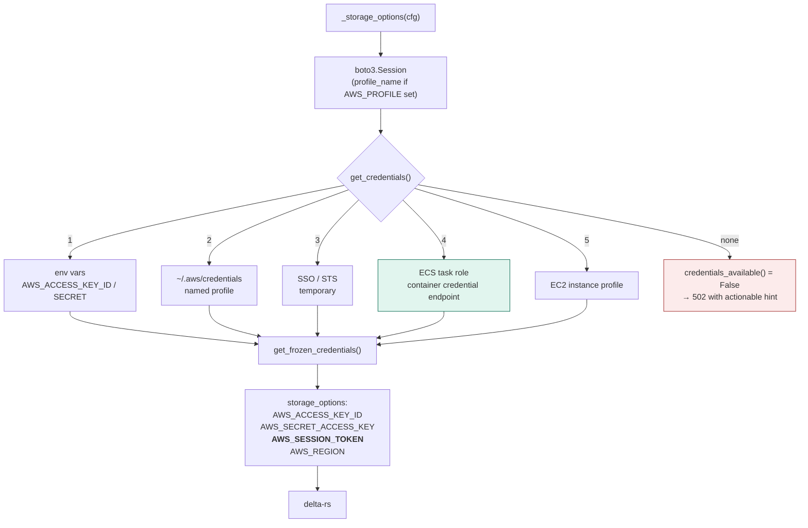

**Why this matters for ECS:** paths 3, 4 and 5 all issue *temporary* credentials
that additionally require `AWS_SESSION_TOKEN`. The original implementation read
only `AWS_ACCESS_KEY_ID` and `AWS_SECRET_ACCESS_KEY` from the environment and
never forwarded a token — so the Parquet write (boto3, full chain) would succeed
while the Delta write failed. ECS delivers task-role credentials through the
container credential endpoint, not env vars. See §12.11.

### 8.2 Failure taxonomy

| Condition | `credentials_available()` | HTTP | Hint |
|---|---|---|---|
| No credentials resolve | `False` | 502 | set `AWS_ACCESS_KEY_ID`/`SECRET` (+ `AWS_SESSION_TOKEN` if temporary), or `AWS_PROFILE`, or use an instance/task role |
| Resolved but rejected | `True` | 502 | check the key is valid and has `s3:PutObject` on the bucket |
| Valid, schema conflict | `True` | 502 | retry with `mode=overwrite` |

`/health` returns **200** in all three cases — a load balancer must not kill the
task over a credential misconfiguration.

---

## 9. Configuration reference

All configuration is environment-driven. No secrets in code.

### AWS

| Variable | Default | Purpose |
|---|---|---|
| `S3_BUCKET` | `tmp-sdp-data` | storage root |
| `S3_REGION` | `us-east-1` | bucket region |
| `AWS_PROFILE` | *unset* | named profile; honoured by both boto3 and delta-rs |
| `AWS_ACCESS_KEY_ID` | *unset* | static credential |
| `AWS_SECRET_ACCESS_KEY` | *unset* | static credential |
| `AWS_SESSION_TOKEN` | *unset* | required for temporary credentials |
| `S3_MAX_RETRIES` | `3` | |
| `S3_RETRY_DELAY_SECONDS` | `1.0` | |

### Solana

| Variable | Default | Purpose |
|---|---|---|
| `SOLANA_RPC_URL` | `https://api.devnet.solana.com` | primary RPC — **devnet is the fellowship target** |
| `SOLANA_RPC_URLS` | *empty* | comma-separated rotation pool |
| `SOLANA_RPC_FALLBACK_URL` | *unset* | single fallback |
| `SOLANA_RPC_TIMEOUT` | `30` | seconds |
| `RPC_MAX_RETRIES` | `3` | |
| `RPC_RETRY_DELAY_SECONDS` | `1.0` | |

### Server

| Variable | Default |
|---|---|
| `HOST` | `0.0.0.0` |
| `PORT` | `8080` |
| `DEBUG` | `false` |

### Data & endpoints

| Variable | Default | Purpose |
|---|---|---|
| `DEFAULT_METRICS_DAYS` | `30` | `/metrics` window — matches the spec |
| `DEFAULT_TRANSFER_LIMIT` | `100` | `/rpc` limit — matches "last 100 transfers" |
| `METRICS_PREFIX` | `metrics` | |
| `INSERT_PREFIX` | `insert` | legacy Parquet prefix |
| `RPC_CACHE_PREFIX` | `rpc-cache` | |

### Ingestion (not in spec scope)

| Variable | Default |
|---|---|
| `INGESTION_INTERVAL_MINUTES` | `15` |
| `INGESTION_MAX_RETRIES` | `3` |
| `INGESTION_RETRY_DELAY_SECONDS` | `60` |
| `TOKEN_DISCOVERY_ENABLED` | `true` |
| `FALLBACK_MINTS` | USDC + PYUSD devnet mints | used when `getProgramAccounts` returns 403 |
| `HOLDERS_INGESTION_ENABLED` | `true` |
| `WHALES_INGESTION_ENABLED` | `true` |
| `VALIDATORS_INGESTION_ENABLED` | `true` |

### Median analysis

| Variable | Default | Purpose |
|---|---|---|
| `MEDIAN_HALF_LIFE_DAYS` | `30.0` | exponential decay for time weighting |
| `MEDIAN_OUTLIER_THRESHOLD` | `3.5` | modified z-score cutoff |
| `MEDIAN_MIN_SAMPLES` | `4` | minimum series length |
| `MEDIAN_REMOVE_OUTLIERS` | `true` | |

### Databricks bridge (legacy — Waddah advised against using this)

| Variable | Default |
|---|---|
| `DATABRICKS_HOST` | *unset* |
| `DATABRICKS_TOKEN` | *unset* |
| `DATABRICKS_WAREHOUSE_ID` | *unset* |

---

## 10. API contracts

### 10.1 `POST /insert`

**Query parameters**

| Param | Required | Default | Values |
|---|---|---|---|
| `table_name` | yes | — | dotted name, e.g. `dev.mlh.polars_metrics` |
| `mode` | no | `append` | `append` \| `overwrite` |
| `timestamp` | no | `true` | `true` \| `false` — adds `ingested_at` |

**Request**

```json
{ "data": [ { "id": 1, "name": "Supply", "unit": "USD",
              "description": "Total circulating supply", "tab": "Stablecoins" } ] }
```

**201 response**

```json
{
  "status": "ok",
  "table": "dev.mlh.polars_metrics",
  "mode": "overwrite",
  "rows": 22,
  "columns": ["id", "name", "unit", "description", "tab"],
  "s3_key": "s3://tmp-sdp-data/dev/mlh/polars_metrics",
  "delta_path": "s3://tmp-sdp-data/dev/mlh/polars_metrics/",
  "parquet_key": "s3://tmp-sdp-data/insert/dev.mlh.polars_metrics/2026-08-05.parquet"
}
```

**Error matrix**

| Status | Condition | `error` |
|---|---|---|
| 400 | no `table_name` | `Missing required query param: table_name` |
| 400 | body lacks `data` | `Request body must contain a 'data' array` |
| 400 | `data` not a non-empty list | `'data' must be a non-empty array of objects` |
| 400 | `data` holds scalars/arrays | `'data' must contain objects, not scalars or arrays` |
| 400 | ragged / mixed-type records | `Could not build a table from 'data'` |
| 400 | bad `mode` | `mode must be 'append' or 'overwrite'` |
| 405 | wrong HTTP verb | *(Flask)* |
| 502 | Delta write failed | `Delta write to S3 failed` + `detail` + `hint` |

### 10.2 `GET /metrics`

| Param | Default | Clamp |
|---|---|---|
| `days` | `30` | `[1, 365]` |

**200**

```json
{
  "days": 30, "count": 20, "source": "dev/mlh/polars_metrics_values",
  "metrics": [ { "date": "2026-07-06", "Supply": 16643202381.88,
                 "DEX Volume": 6117296684.87, "Validator Count": 1032.0 } ]
}
```

**503** when the source table is unreadable — missing table *or* credential
failure. Explicitly **not** a 200 with an empty array, which would misreport an
outage as "no data".

### 10.3 `GET /rpc`

| Param | Required | Default | Clamp |
|---|---|---|---|
| `token_address` | yes | — | — |
| `limit` | no | `100` | `[1, 1000]` |

**200**

```json
{
  "token_address": "So1111…", "source": "rpc",
  "transfers": [ { "signature": "4SY8…", "slot": 436401818,
                   "mint": "So1111…", "owner": "…", "change": 10000000,
                   "ui_change": 0.01, "decimals": 9 } ],
  "total": 11, "scanned": 10, "cached_before": 1, "newly_cached": 10
}
```

`scanned` vs `total` matters: `getSignaturesForAddress` returns every
transaction *referencing* the address, and most move no tokens. Surfacing both
makes an empty result legible instead of looking broken.

---

## 11. Deployment topology

### 11.1 Container

```dockerfile
FROM python:3.12-slim
RUN apt-get install libgomp1 curl        # libgomp1 required by Polars
COPY requirements.txt . && pip install --no-cache-dir -r requirements.txt
COPY . .
EXPOSE 8080
CMD ["gunicorn", "--bind", "0.0.0.0:8080", "--workers", "1", "--threads", "4",
     "--timeout", "120", "app:create_app()"]
```

| Property | Value | Rationale |
|---|---|---|
| Base | `python:3.12-slim` | smallest image with a working Polars wheel |
| System deps | `libgomp1`, `curl` | OpenMP for Polars; curl for healthcheck |
| Image size | 775 MB (full) / 701 MB (`/insert` only) | pyarrow + polars dominate |
| Workers | **1** | `create_app()` starts the scheduler — see §4.1 |
| Threads | 4 | I/O-bound workload (S3 + RPC) |
| Entrypoint | `app:create_app()` | gunicorn factory syntax |

### 11.2 Two known container caveats

1. **`--workers` must stay 1** for the full service. Scale with ECS tasks.
2. **flask-socketio needs a gevent/eventlet worker class.** Under the `threads`
   worker, `/ws/*` is degraded. The three spec endpoints are unaffected, and
   WebSockets are not in scope.

The `/insert`-only build has neither constraint — no scheduler, no sockets — and
runs `--workers 2`.

### 11.3 Target ECS topology

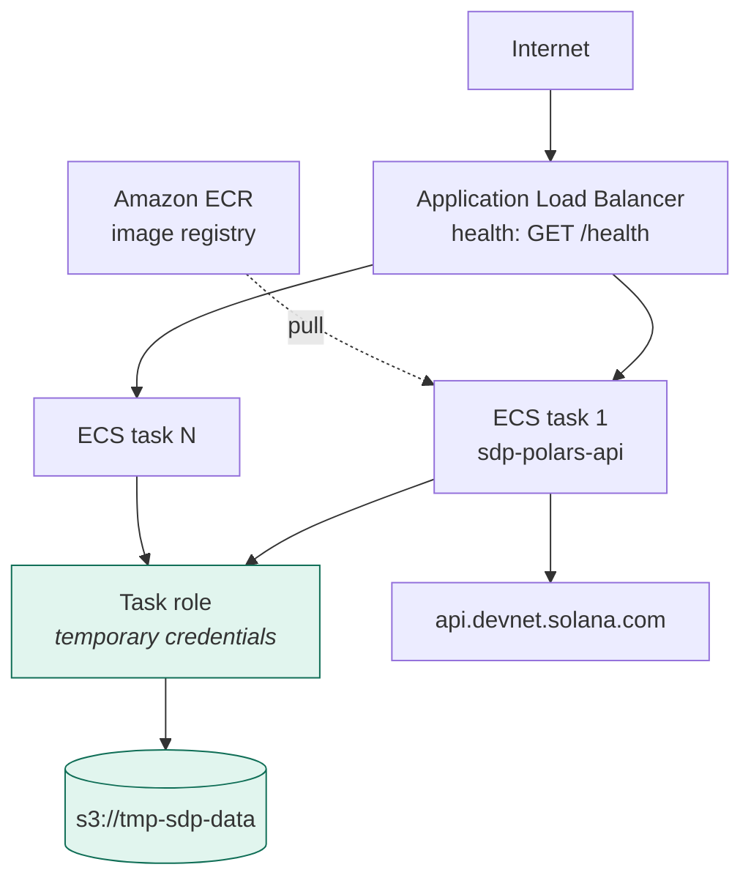

**Status: not deployed.** Blocked on `ecr:*` and `ecs:*` IAM permissions,
requested 2026-07-20, not yet granted.

Task-role credentials are exactly the case the §12.11 fix unblocked — without
it, every Delta write on ECS would have failed.

---

## 12. Defects found and fixed

Twelve defects. **Seven were silent** — wrong data, no error, no log line.

| # | Component | Defect | Severity |
|---|---|---|---|
| 1 | `/metrics` | `partition_by` iteration → HTTP 500 on every request | Critical |
| 2 | `/metrics` | 4 of 9 metric names wrong | **Silent corruption** |
| 3 | `/rpc` | balances matched on `owner`, not `accountIndex` | **Silent** |
| 4 | `/rpc` | non-transfers returned as empty-mint rows | **Silent** |
| 5 | `/rpc` | deprecated `uiAmount` → 0.0 for real movements | **Silent** |
| 6 | `/rpc` | cache short-circuit ignored `limit` | Spec violation |
| 7 | `/rpc` | returned a *different token* than queried | **Silent** |
| 8 | `/rpc` | append-only cache, no dedupe | Latent |
| 9 | `/metrics` | timestamp-vs-Date cutoff → time-of-day dependent | **Silent** |
| 10 | median | `trimmed_mean` asymmetric → 17% low at n=5 | **Silent** |
| 11 | `s3_service` | `AWS_SESSION_TOKEN` never forwarded | **ECS-blocking** |
| 12 | median | `outlier_threshold` parsed but never used | Silent |

### 12.1 `/metrics` returned 500 on every request

```
TypeError: tuple indices must be integers or slices, not str
  metrics.py:77  date_val = str(date_group["date"][0])
```

`partition_by(as_dict=True)` returns `{key_tuple: frame}`. Iterating a dict
walks its **keys**, so `date_group` was a tuple. Fixed with
`partition_by(maintain_order=True)`, which yields frames.

### 12.2 Four metric names were wrong

| id | reported | actual |
|---|---|---|
| 14 | DEX Transactions | **Slots** |
| 25 | Validator Count | **DEX Transactions** |
| 28 | Slots | **SOL Price (Network)** |
| 29 | SOL Price (Network) | **Validator Count** |

Slot counts were being served labelled as DEX transactions. Names now come from
the Delta catalog, cached per process, with a corrected 22-entry static
fallback. Only 9 of 22 metrics had names before; all 22 do now.

### 12.3–12.5 `/rpc` parser, against the RPC spec

Validated against `solana.com/docs/rpc/json-structures`:

- **`owner` is optional** in `pre/postTokenBalances`, and one owner can hold
  several accounts for the same mint. Matching on it dropped transfers and
  mismatched rows. Now matched on `accountIndex`, as the spec requires.
- **`_parse_transfer` never returned `None`** despite its signature, so
  non-transfer transactions came back as rows with empty `mint` and zeroed
  amounts.
- **`uiAmount` is documented as deprecated** and is frequently `null`; the
  `or 0` fallback reported **0.0 for real token movements**. Now derived from
  the raw amount and `decimals`.

Proof, on a synthetic transaction with `uiAmount: null` and a real 2.5-token
movement: old code → `0.0`, new code → `2.5`.

### 12.6 The limit was not honoured

```
asked limit=3    returned 1
asked limit=50   returned 1
asked limit=100  returned 1
```

Any cached row short-circuited the request, and that mint never refetched. The
spec says *"returns last 100 transfers"*. The cache is now authoritative only
when it holds at least `limit` rows.

### 12.7 The response described the wrong token

`getSignaturesForAddress` returns every transaction referencing an address, and
those routinely move several mints. `_token_change` took the first delta it
found. Confirmed against the live cache — a query for the USDC mint had stored
rows under **four unrelated mints**:

```
distinct mints cached: 5     rows for the USDC mint: 1
```

Fixed by preferring the delta whose mint matches the queried address. This also
repaired the cache key, which was written under the moved mint but looked up by
the queried address.

### 12.9 `/metrics` results depended on the time of day

The cutoff was a *timestamp* compared against a *Date* column, so the boundary
day was included or dropped depending on the hour:

```
same query, afternoon : 1732 rows
same query, 02:00     : 1829 rows
```

Now a date. Discovered only because converting to `scan_delta` produced a
different row count than the eager path.

### 12.10 `trimmed_mean` was biased low

```
n=3   dropped_low=0  dropped_high=1   asymmetric
n=5   dropped_low=0  dropped_high=1   asymmetric
n=10  dropped_low=1  dropped_high=1   symmetric
```

`int(n*0.1)` floors to 0 for n<10 while `int(n*0.9)` still truncates the top.
At n=5 it returned **2.5 against a true mean of 3.0 — 17% low**. With
`MEDIAN_MIN_SAMPLES=4`, small samples are the normal case.

### 12.11 `AWS_SESSION_TOKEN` was never forwarded

```python
# before
ak = os.environ.get("AWS_ACCESS_KEY_ID")
sk = os.environ.get("AWS_SECRET_ACCESS_KEY")
if ak and sk: ...          # no token, no profile, no chain
```

Named profiles, SSO/STS sessions and **ECS task roles** all issue temporary
credentials requiring a session token. `write_parquet` (boto3, full chain) would
succeed while `write_delta` failed — with an opaque
`OSError: Kernel error -> Operation not supported`.

This would have failed on the first ECS deploy.

---

## 13. Verification matrix

Last full run: 2026-08-05, commit `a8cea7f`, local in sync with
`polars-api-only`.

| Layer | Method | Result |
|---|---|---|
| Compile | `py_compile` across the tree | **28 files, 0 failures** |
| Dependencies | AST import trace vs `requirements.txt` | **0 missing** |
| Unit — all fixes | synthetic fixtures | **20/20** |
| Devnet E2E | one step per architecture arrow | **27/27** |
| `/insert` suite | route surface, spec case, modes, validation, Delta layout | **43/43** |
| Smoke test | `scripts/smoke_test.py` vs container | **all passed** |
| Docker | build + run + healthcheck | **healthy, 0 tracebacks** |
| Real HTTP | 13 endpoints via curl | **0 5xx** |
| Data fidelity | null, unicode, int64 > 2^53, 5000 rows | **exact** |
| Concurrency | 12 parallel appends | **0 lost writes** |
| Credentials | none / bad / profile / session token | **correct 502 + hints** |
| S3 round trip | independent read-back | **byte-identical** |
| Browser | rendered via in-app browser | **`{"status":"ok"}`** |

### Notable evidence

**Data fidelity** — hostile values survived HTTP → Polars → Delta → S3 → back:

```
dtypes preserved            Int64, Float64, String, Boolean
null stays null             yes
int64 beyond 2^53 exact     9007199254740993 survived
unicode                     ünïçødé 日本語
newline / quotes / backslash in strings   yes
5000-row payload            201, read back (5000, 3), sum matches
```

**Concurrency** — the riskiest area, given `AWS_S3_ALLOW_UNSAFE_RENAME=true`:

```
12 concurrent appends -> all 201
expected 13 rows, actual 13
_delta_log: commits 0..12, contiguous, no gaps
LOST WRITES: 0
```

**The deliverable** — verified repeatedly:

```
dev/mlh/polars_metrics   (22, 5)   matches source CSV exactly: True
```

---

## 14. Branch topology

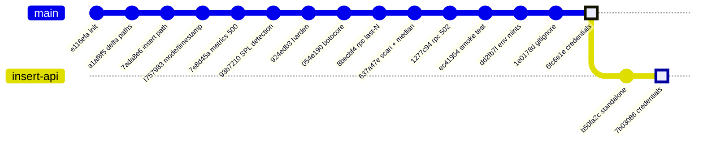

### Remote branches — `waldruupi/tmp-sdp-data`

| Branch | Head | Credential fix | Description |
|---|---|---|---|
| **`polars-api-only`** | `6fc6e1e` | yes | **full service — the primary artifact** |
| **`insert-api`** | `7b03086` | yes | `/insert` only, 14 files, 701 MB |
| `main` | `f780df2` | no | Waddah's own |
| `fix-insert` | `60eec58` | no | superseded experiment |
| `minimal-api` | `1c97078` | no | superseded experiment |
| `minimal-api-keep-files` | `6032279` | no | superseded — same SHA as below |
| `waddah-review` | `6032279` | no | superseded — duplicate |
| `johnnie-branch` | `bf1afe9` | no | historical monorepo push |
| `ari-branch2` | `06b410e` | no | Ari's `sdp-metrics-api` |

**Only the two shipping branches carry the credential fix.** Any of the others,
if deployed to ECS, would fail on the Delta write.

### The two artifacts compared

| | `polars-api-only` | `insert-api` |
|---|---|---|
| Endpoints | 25 routes | 2 routes |
| `/insert` `/metrics` `/rpc` | all three | `/insert` only |
| Dependencies | 11 packages | 7 packages |
| Image size | 775 MB | 701 MB |
| Gunicorn workers | 1 (scheduler) | 2 (no background threads) |
| Background scheduler | yes, 15 min | none |
| WebSockets | yes (degraded under threads worker) | none |

`config.py`, `src/routes/insert.py` and `src/services/s3_service.py` are
**byte-identical** between the two — verified with `cmp`. This is a packaging
split, not a fork.

---

## 15. Operational runbook

### Local

```bash
cd sdp-polars-api
pip install -r requirements.txt
export AWS_ACCESS_KEY_ID=…  AWS_SECRET_ACCESS_KEY=…  AWS_DEFAULT_REGION=us-east-1
python app.py                       # http://localhost:8080
python scripts/smoke_test.py        # exercises all three endpoints
```

### Docker

```bash
docker build -t sdp-polars-api sdp-polars-api/
docker run -p 8080:8080 \
  -e AWS_ACCESS_KEY_ID=… -e AWS_SECRET_ACCESS_KEY=… \
  -e AWS_DEFAULT_REGION=us-east-1 \
  sdp-polars-api
```

### Writing the catalog

```bash
curl -X POST -H "Content-Type: application/json" --data @catalog.json \
  "http://localhost:8080/insert?table_name=dev.mlh.polars_metrics&mode=overwrite&timestamp=false"
```

### Verifying in Databricks

```sql
SELECT * FROM delta.`s3://tmp-sdp-data/dev/mlh/polars_metrics`;
```

### Triage

| Symptom | Cause | Action |
|---|---|---|
| 502, hint *"No AWS credentials resolved"* | credential chain empty | set env vars, `AWS_PROFILE`, or attach a task role |
| 502, hint *"credentials resolved but rejected"* | wrong key or missing `s3:PutObject` | check the IAM policy |
| 502, hint *"Schema differs"* | column set changed | retry with `mode=overwrite` |
| 503 from `/metrics` | source Delta table unreadable | check the table exists and credentials work |
| `/metrics` returns `count: 0` | no rows in the window | data is stale — check ingestion |
| `/rpc` returns 0, `scanned` > 0 | scanned transactions moved no tokens | expected on sparse devnet |
| 429 in logs | public RPC rate limit | set `SOLANA_RPC_URLS` for rotation |
| duplicated 15-min snapshots | `--workers` > 1 | pin to 1, scale with tasks |

---

## 16. Known limitations and open items

### Blocking the deliverable

**ECS deployment — not done.** Requires `ecr:*` and `ecs:*` on the IAM user.
Requested 2026-07-20, still outstanding. This is the only unfinished item in the
project brief. `deploy/ecs-task-def.json` and `deploy/deploy-ecs.ps1` exist but
predate this session and should be reviewed against the current image before use.

### Unverified claims

**"Readable on Databricks" is inferred, not observed.** What has been proven:
the table is Delta at reader protocol v1, and an independent process reads back
byte-identical data from S3. What has **not** happened: anyone running a query
inside the Databricks workspace. One statement closes this.

### Technical debt

| Item | Detail | Risk |
|---|---|---|
| Concurrent writes | `AWS_S3_ALLOW_UNSAFE_RENAME=true` disables delta-rs multi-writer protection. 12 parallel writes passed cleanly, but that is evidence, not a guarantee | add a DynamoDB locking provider before multi-task ECS |
| Scheduler in the web process | `create_app()` starts it, forcing `--workers 1` | move to a separate task or use an ECS scheduled task |
| WebSockets under gunicorn | flask-socketio needs gevent/eventlet | switch worker class, or drop the subsystem |
| `/rpc` cache has no TTL | rows never expire | add a freshness window |
| Legacy Parquet mirror | every insert writes twice | remove once nothing reads the `insert/` prefix |
| `read_parquet` loads whole objects | boto3 → `BytesIO`, no pushdown | migrate to `pl.scan_parquet("s3://…")` |
| Scratch data in S3 | 26 test tables under `dev/mlh/` | run the cleanup script |

### Security

**An AWS access key was exposed in plaintext during development and must be
rotated** (key id withheld here; it is the one issued to the fellowship IAM user
in account `017605949106`). No credential appears in any tracked file,
branch, or commit — verified by scanning the full history. `.env` is gitignored;
`.env.example` carries placeholders only.

---

## Appendix A — spec traceability

| Spec line | Implementation | Verified |
|---|---|---|
| `GET /metrics` reads Delta from S3, last 30 days | `metrics.py`, `DEFAULT_METRICS_DAYS=30` | 200, 20 buckets, 22 named metrics |
| `POST /insert` writes Delta readable on Databricks | `insert.py` → `write_delta` | 201, 22 rows, byte-exact round trip |
| `GET /rpc` checks S3 first, else RPC | `rpc.py` cache-first | both paths exercised |
| `GET /rpc` returns last 100 transfers | `DEFAULT_TRANSFER_LIMIT=100` | limit honoured, dedupe verified |
| `GET /rpc` stores in S3 | `write_delta("rpc_cache")` | append with signature dedupe |
| Flask API app | `app.py` | 25 routes |
| Containerize with Docker | `Dockerfile` | builds, runs, healthy |
| Use Polars as the data framework | throughout, incl. `scan_delta` pushdown | — |
| `s3://tmp-sdp-data` | `S3_BUCKET` default | — |
| **Deployed on ECS** | `deploy/` | **not done** |

## Appendix B — external references

| Resource | Relevance |
|---|---|
| [`rpc/json-structures`](https://solana.com/docs/rpc/json-structures) | pre/post token balances — source for defects 3, 4, 5 |
| [`getSignaturesForAddress`](https://solana.com/docs/rpc/http/getsignaturesforaddress) | `/rpc` signature enumeration |
| [`getTransaction`](https://solana.com/docs/rpc/http/gettransaction) | transaction metadata |
| [Polars cloud storage](https://docs.pola.rs/user-guide/io/cloud-storage/) | `scan_delta` predicate pushdown |
| [Solana clusters](https://solana.com/docs/references/clusters) | devnet endpoint |
| [SDP repository](https://github.com/solana-foundation/solana-developer-platform) | integration target |
